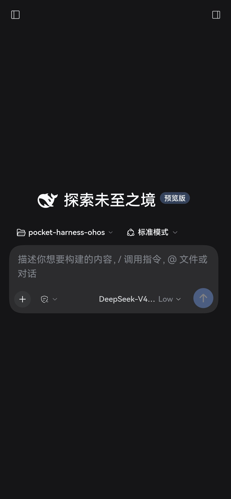
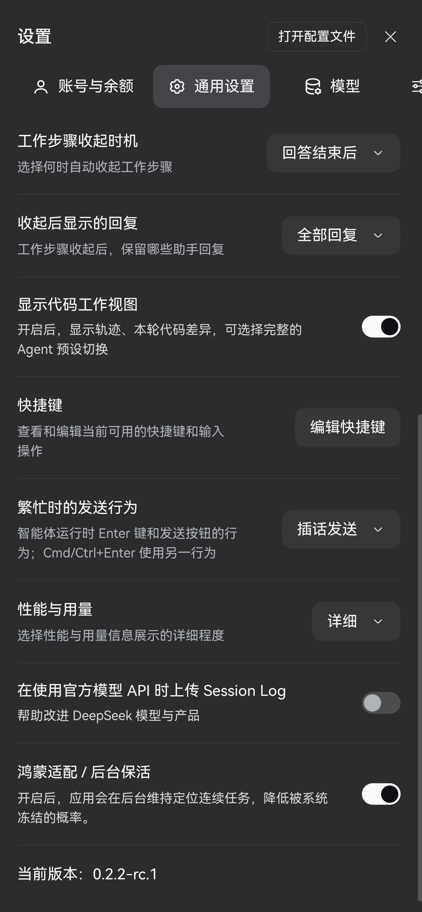
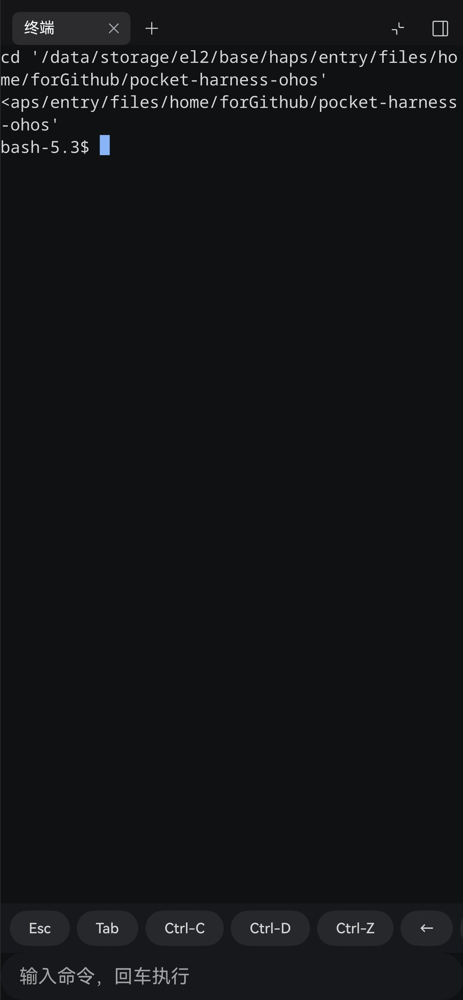
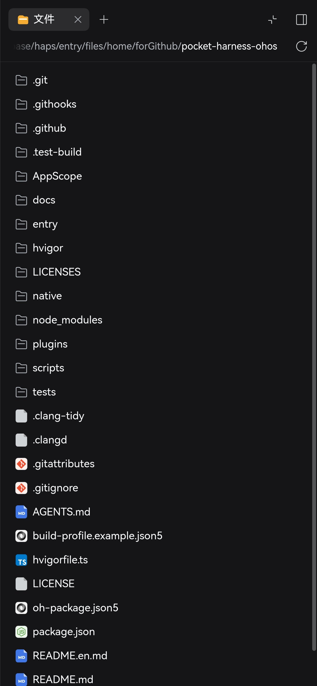
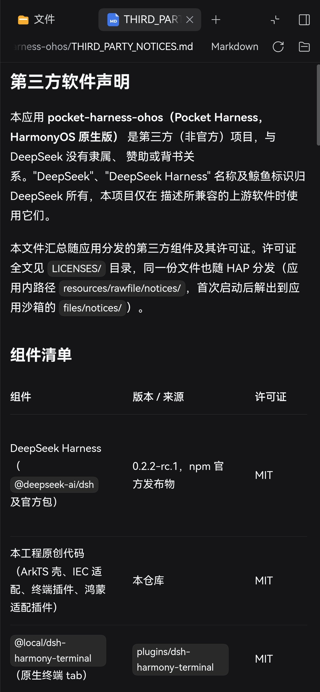

# Pocket Harness · HarmonyOS Native Edition

English | [简体中文](README.md)

> **Unofficial project.** Maintained by the community; not affiliated with, sponsored by, or endorsed by DeepSeek. "DeepSeek", "DeepSeek Harness" and the whale logo belong to DeepSeek. See [THIRD_PARTY_NOTICES.md](THIRD_PARTY_NOTICES.md) for licensing and third-party components.

This project packages the **official DeepSeek Harness** as a HarmonyOS app. The UI is the official web GUI (`dsh --profile web`); the agent loop, tool calls, approvals, sessions and workspaces come from `@deepseek-ai/dsh`. Node, Bash, toybox, libarchive and ripgrep are cross-compiled for `aarch64-linux-ohos` and shipped as native libraries inside the HAP — no adb, Termux or remote server required. The terminal is rendered natively with libvterm as a closable tab in the right sidebar.

| Item | Value |
| --- | --- |
| App name | Pocket Harness |
| Bundle | `com.snoworwind.phoh` |
| Version | `0.1.0.6` (versionCode 7) |
| Min / target API | HarmonyOS 5.1.0 (API 18) / API 24 |
| Engine | `@deepseek-ai/dsh` 0.2.2-rc.1 (web profile, 291 plugins) |
| Runtime | Node 24.22.1 (`--jitless`), Bash 5.3, Git 2.56.0 (with HTTPS), toybox 0.8.14, libarchive 3.7.7, ripgrep 14.1.1, CPython 3.12.14 (with pip), curl 8.22.0, jq 1.7.1, Dropbear SSH, less/Vim, SQLite 3.50.4, rsync 3.4.1, xz 5.8.1, zstd 1.5.7, gh, Git LFS |
| Distribution | GitHub Release: unsigned HAP + arm64/x86_64 native libraries (**no AppGallery release is planned for now**) |

> This project is **not intended for Huawei AppGallery** for now. It is distributed only through
> GitHub Releases as an unsigned HAP plus prebuilt native libraries; users must sign it with their
> own debug certificate before installing. The `.app` packaging step below is kept only for a
> possible future store release.

## Screenshots

Captured on a device (click for full size):

| Home | Settings |
| :---: | :---: |
| <a href="docs/images/home.jpg"></a> | <a href="docs/images/settings.jpg"></a> |

| Built-in terminal | File browser |
| :---: | :---: |
| <a href="docs/images/terminal.jpg"></a> | <a href="docs/images/files.jpg"></a> |

The file tab previews Markdown and other text files in place:

<p align="center">
  <a href="docs/images/files-preview.jpg"></a><br>
  <sub>File preview: <code>THIRD_PARTY_NOTICES.md</code> rendered as Markdown</sub>
</p>

## Features

- **Official web GUI**: agent loop, tools, approvals, sessions and workspaces are the upstream engine; the UI is not reimplemented.
- **Native terminal**: a closable right-sidebar tab with PTY and job control (`Ctrl-Z`, `fg`, `bg`), libvterm rendering, IME-aware layout and orientation support. It starts in the current DSH session's working directory and follows session/workspace switches.
- **Built-in Git**: `git` and `git-remote-http(s)` are cross-compiled from source into IEC shared libraries and use the app's CA bundle, so `clone`/`fetch`/`push` over HTTPS work without an external toolchain.
- **Back gesture**: closes overlays in priority order — menu → settings dialog → right sidebar/terminal → left drawer → system. Collapsing the terminal keeps the process running; only the tab's × stops it.
- **Immersive and system bars**: the app is full screen by default and insets content around the camera cutout and gesture bar; Settings → General → HarmonyOS adaptation can show the system status and navigation bars again.
- **Attachments**: ArkWeb has no reliable blob-Worker upload path, so a document-start `fetch` hook sends uploads on the main thread; images are identified from file headers and passed through unchanged in an engine without sharp/WASM.
- **Quote popover**: the "quote text" button is placed below the selection, clear of the system selection toolbar.
- **Pinch zoom disabled**: the layout is viewport-based; zoom would break terminal/sidebar geometry.
- **No JIT**: Node runs with `--jitless`, so undici's WASM-based fetch is unavailable; a pure-JS `fetch` polyfill is injected at runtime.
- **TLS trust**: Mozilla roots plus an optional `extra-ca.pem` (development HTTPS interception CA); certificates are always fully verified.

## Layout

```text
entry/src/main/ets
  ├─ pages/Index.ets             Web component, bridge messages, back gesture, boot states
  ├─ pages/Terminal.ets          libvterm view and PTY session
  └─ platform/NativeRuntime.ets  engine unpacking, dsh web, CA bundle, launchers

plugins/
  ├─ dsh-harmony-terminal/       terminal tab: registration, stage bounds, open/close/focus, cwd
  └─ harmony-compat/             HarmonyOS adaptation: overlay state, quote popover

native/
  ├─ iec/                        IEC execution core (from Bettersh): exec/tty/fs shims, ELF loader
  ├─ terminal/                   libvterm and terminal NAPI
  └─ toolchain/                  Node 24 / native addon OHOS toolchain

scripts/
  ├─ build.mjs                   HAP build (Windows/macOS/Linux, auto-detects DevEco)
  ├─ build-x86-runtime.sh        staged x86_64 emulator runtime build
  ├─ pack-native.sh              native libs + engine archive → entry/
  ├─ runtime-manifest.mjs        compute/verify runtime version from shipped bytes
  └─ test-fetch-polyfill.cjs     19 fetch-polyfill regression tests
```

## Building

### 1. Native runtime (WSL / Linux)

arm64 devices:

```bash
bash native/toolchain/build-node24.sh        # Node 24.22.1 (jitless), the slow one
bash native/build-bash.sh                    # Bash 5.3 (GPL-3.0)
bash native/iec/scripts/build_toybox.sh      # toybox
bash native/iec/scripts/build_libarchive.sh  # tar/cpio/unzip/zip
bash native/iec/scripts/optional/build_git.sh # Git 2.56.0 (GPL-2.0, with HTTPS)
bash scripts/pack-native.sh                  # libs + engine archive → entry/
```

The Git target statically links zlib, PCRE2, OpenSSL and libcurl into two `.so` files; the script
downloads and builds missing dependencies on the first run. For cross-compiling on macOS, set
`OHOS_SDK`, `CLANG` and `JOBS` as shown in `native/iec/scripts/env.sh.example`, and make the SDK's
`llvm-ar`/`llvm-nm` tools available on `PATH`.

x86_64 emulator: see [docs/X86_64-BUILD.md](docs/X86_64-BUILD.md) and the `setup / node / tools /
bash / addons / rg / pack` phases of `scripts/build-x86-runtime.sh`.

The toolchain, official engine and source caches default to `/var/tmp/deepseek-harmony-native` on the
build host (override with `NATIVE_BASE`); `native/toolchain/README.md` explains the LLVM 22 +
libc++ 22 `__n1` setup.

### 2. HAP

```bash
# Only Node 18+ is required; a full DevEco installation is enough (no IDE session)
node scripts/build.mjs --deveco-home "<DevEco install dir>"
node scripts/build.mjs --clean   # after changing native libs
```

Before packaging, `build.mjs` recomputes `runtime-manifest.json`'s `version` from the exact engine,
npm and native libraries that will ship, so no manual bump is needed. `pack-native.sh` also calls the
same `scripts/runtime-manifest.mjs`, which means it now requires Node 18+ on the build host. Release
pipelines should add `--strict-runtime-manifest` to fail on a stale manifest instead of writing it
back; `npm run runtime:check` runs the same gate standalone.

`build-profile.json5` is gitignored (it contains signing paths and passwords); only
`build-profile.example.json5` is committed. Signing is configured locally.

### 3. App pack (optional, only for a future store release)

This project is **not planned for AppGallery** for now, so this step is normally unnecessary. If you
do want a store package later, run `assembleApp` in project mode:

```bash
# Point at DevEco's SDK and JBR; alternatively use Build → Build App in DevEco
DEVECO_SDK_HOME="<DevEco>/sdk" JAVA_HOME="<DevEco>/jbr" \
  node "<DevEco>/tools/node/node.exe" "<DevEco>/tools/hvigor/bin/hvigorw.js" \
  --mode project -p product=default -p buildMode=release assembleApp --no-daemon
```

Output: `build/outputs/default/*.app`; the single HAP is at
`entry/build/default/outputs/default/entry-default-signed.hap`.

## Signing and distribution

- **On-device debugging** requires a debug profile for `com.snoworwind.phoh` that lists the
  device UDID (generate it in DevEco → Project Structure → Signing Configs).
- **GitHub Releases** ship an **unsigned** HAP and native libraries; sign them yourself before
  installing.
- This project is **not intended for Huawei AppGallery**; if you publish it yourself, you need a
  release certificate/profile and you are responsible for store review, filings, trademark and
  AI-service compliance.
- A **release-signed HAP cannot be installed with `hdc install`** (`9568322 not trusted app
  source`); do not use it for local testing.

## Tests

```bash
node scripts/test.cjs                  # 57 host-side tests (session protocol, SSE, path sandbox, upload hook, image patch)
node scripts/test-fetch-polyfill.cjs   # 19 fetch-polyfill tests (JSON/SSE/redirect/FormData/abort)
bash scripts/audit-sources.sh          # unpack the HAP, verify binaries and npm.tar.gz
bash scripts/check-engine-web.sh       # web profile: 291 plugins, empty stderr
```

See [docs/VALIDATION.md](docs/VALIDATION.md) for what has been verified on device and what has not.

## Runtime layout

```text
filesDir/
  runtime-<version>/           bin/     command launchers (#IECSOv2)
                               engine/  official engine + harmony/ host scripts
                               certs/   cacert.pem + bundle.pem
                               home/ tmp/
  harness-home/                DSH_HOME (profiles, sessions, settings, credentials)
```

- The runtime directory name comes from the content digest computed by
  `scripts/runtime-manifest.mjs`; `build.mjs` recomputes and writes it before every build, so
  changing the engine, npm or any native library triggers a fresh unpack. Stale `runtime-*`
  directories are removed after a successful start (~450 MB each).
- An OTA update that only changes ArkTS/UI keeps the same runtime and reuses the old directory.
  Its startup then behaves exactly like a normal cold start; no unpack prompt is expected.
- `.installed` must contain the current `manifest.version`, otherwise the whole runtime is rebuilt.
- `harness-home` is never deleted by the app: upgrades keep sessions and settings.
- Corrupted runtimes are rebuilt automatically once, then the UI offers a "re-unpack" action.

### Startup phases

| Case | What the launch screen shows |
| --- | --- |
| First install / cleared data / changed runtime | "Unpacking the official engine and npm" plus first-launch copy. Unpacking is synchronous, so the spinner may pause |
| OTA update with an unchanged runtime | Same as a normal cold start; no unpack prompt |
| Normal cold start | Starting local runtime → starting the official web service → restoring the previous session and workspace; the screen is removed only after the first session mounts |

The official Web GUI's `onPageEnd` only means static assets are loaded; the composer and right
sidebar are not ready yet. The launch screen covers the WebView and blocks touches until
`[data-conversation-session]` appears, with a 60-second fallback measured from the moment the home UI appears (plus a 120-second absolute fallback for a WebView that never mounts).

After the optimization below, this device reaches a usable screen in about **11–15 s**; the first install still spends extra time unpacking the ~47 MB engine archive.

## Runtime patches

### Startup performance

On HarmonyOS, `process.report.getReport()` is extremely expensive because it enumerates CPU and
network details. The native addon loader only calls it to distinguish musl from glibc, but that
call blocks the Node event loop for about 30 seconds. `harmony/runtime-preload.cjs` returns a
minimal report for **no-argument** `getReport()` calls, so the loader proceeds as musl immediately.

Measured cold start to usable dropped from about **50–55 s to 11–15 s**, and
`/api/session/create` from 32.4 s to about 0.3 s. Set `DSH_LITE_REPORT=0` to restore the full
report when diagnosing.

### fetch / TLS

Node runs with `--jitless` on HarmonyOS, so V8 does not expose WebAssembly and the built-in
`fetch` (undici) cannot parse HTTP. The runtime injects a pure-JS
`harmony/fetch-polyfill.cjs` via `NODE_OPTIONS=--require`:

- request bodies: string / Buffer / TypedArray / ArrayBuffer / URLSearchParams / Blob /
  FormData (multipart) / ReadableStream / Node Readable;
- responses: streaming bodies (SSE is not buffered), gzip/br/deflate;
- redirects follow/error/manual with method rewriting; `AbortSignal` rejects with
  `AbortError`; HEAD/204/304 have a null body; responses expose `url/type/redirected`.

V8 DrumBrake (the WASM interpreter) is not viable here: the DrumBrake sources bundled with Node
24.22.1 no longer compile against the same V8 (about 50 errors), and the interpreter still
allocates executable memory, which conflicts with HarmonyOS's no-JIT policy.
`scripts/patch-v8-drumbrake.sh` is kept only as a record of the investigation.

TLS trust comes from the runtime CA bundle: Mozilla roots plus an optional
`rawfile/harmony/extra-ca.pem`, merged into `certs/bundle.pem` at startup. `extra-ca.pem` is the
root CA of an HTTPS interception proxy used in some development environments and is **not shipped
in this repository**; provide it yourself if needed. Public/store builds should leave it absent
(Mozilla roots only) or replace it with your own enterprise root.

### Attachments and images

The browser-side attachment transport is "blob URL + Web Worker" (`workerTransport`), which is
unreliable on ArkWeb: the worker script may not have fetched the blob URL before
`revokeObjectURL` runs. The app injects a `fetch` hook (`globalThis.__DSH_FILE_UPLOAD__`) at
document start; the client prefers it and uploads through same-origin `fetch` on the main thread
(cookies still apply). If the kernel rejects a Blob body, the hook retries once with an ArrayBuffer.

Images have a second problem: the shipped engine intentionally contains no native binaries,
`dsh-attachment-local` calls `requireSharp()` on every image path, and the WASM fallback cannot
run under `--jitless`. `scripts/pack-native.sh` therefore appends a pure-JS fallback
(`scripts/engine-patch/`) to `dsh-attachment-local/lib/index.js`: PNG/JPEG/WebP/GIF are identified
from their headers and pass through byte-identically once admission limits are met. The tradeoff
is no EXIF rotation, no 2048² downscaling and no 8-bit sRGB normalization; only admission limits
such as `maxImageBytes` bound very large sources.

A second, HarmonyOS-only failure happens while persisting: the attachment package fsyncs every
ancestor from `DSH_HOME` up to the filesystem root, but the app sandbox cannot
`open('/data/storage/el2')`, so every attachment fails with `EACCES` before any byte is written.
The fallback stops the upward fsync at `EACCES`/`EPERM` while still syncing every level below the
sandbox boundary.

## Known limitations

- First launch unpacks a 47 MB engine archive (~27k files), about 1–2 minutes on a phone.
- Background keep-alive uses a location continuous task; it needs approximate-location permission
  and only affects background survival.
- `dsh web` binds `127.0.0.1` only; the UI is reachable only from the in-app Web component.
- The engine's process sandboxing (bwrap / Landlock) is generally unavailable on HarmonyOS;
  capability limits come from permission presets and tool switches.
- Image attachments use the pure-JS fallback: header validation plus byte pass-through, no
  re-encoding. EXIF orientation, large-image downscaling and 16-bit/CMYK normalization are no
  longer performed by the engine.
- `fork` is not intercepted; the terminal PTY relies on `forkpty` compatibility.
- Not included: MCP console, voice, plugin marketplace, persistent background execution. Python is bundled, but there is no on-device `make`/`cc`; pip packages with native extensions must be built on the host.

## Licensing

- Original code: MIT, see [LICENSE](LICENSE).
- Upstream DeepSeek Harness: MIT; copyright and permission notices are kept in the shipped archive.
- Third-party components, license texts and the corresponding source for GNU Bash:
  [THIRD_PARTY_NOTICES.md](THIRD_PARTY_NOTICES.md).
- License texts live in `LICENSES/` and are shipped inside the HAP, extracted to `files/notices/`.
- Component provenance and build recipes: [docs/SOURCES.md](docs/SOURCES.md).
