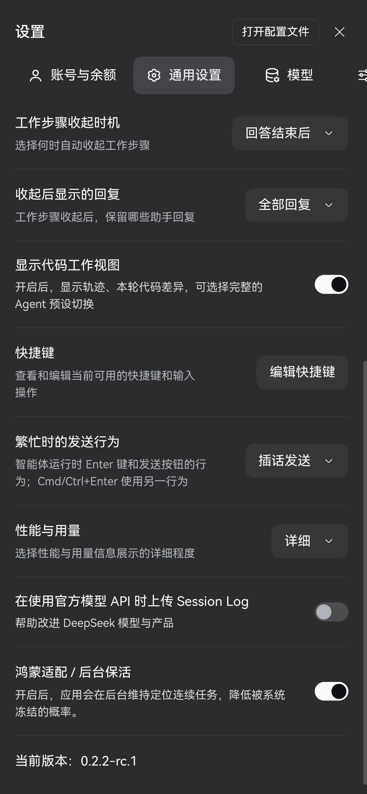
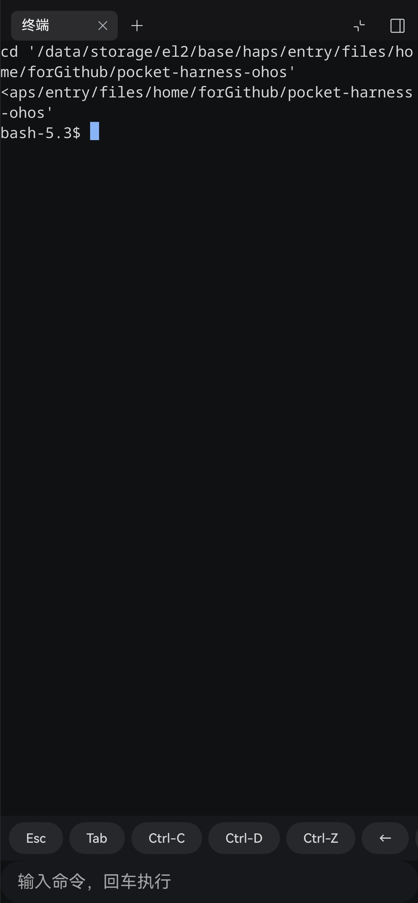
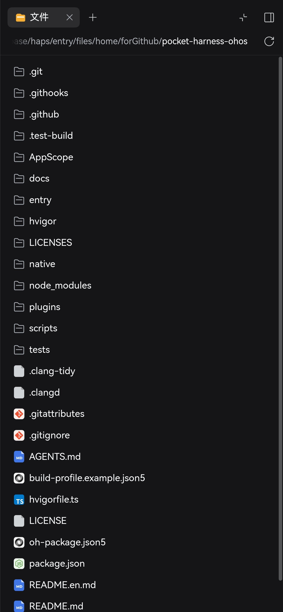
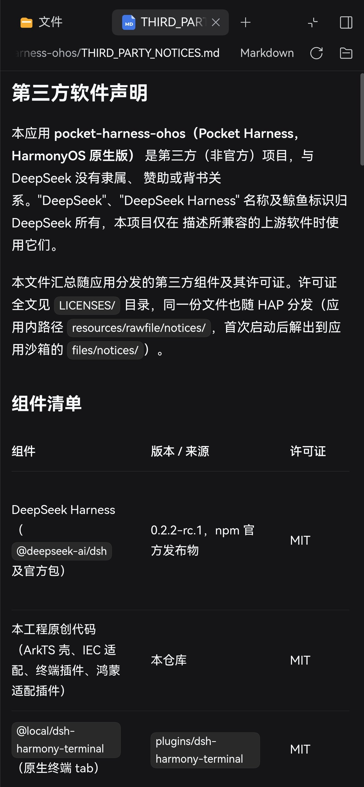

# Pocket Harness · HarmonyOS 原生版

[English](README.en.md) | 简体中文

> **非官方项目**：本项目由社区维护，与 DeepSeek 没有隶属、赞助或背书关系。"DeepSeek"、"DeepSeek Harness" 名称及鲸鱼标识归 DeepSeek 所有。许可与第三方组件声明见 [THIRD_PARTY_NOTICES.md](THIRD_PARTY_NOTICES.md)。

把**官方 DeepSeek Harness** 整个搬进鸿蒙应用：界面就是官方 Web GUI（`dsh --profile web` 的浏览器前端），Agent Loop、工具调用、审批、会话、工作区都由官方 `@deepseek-ai/dsh` 提供；Node、Bash、toybox、libarchive、ripgrep 针对 `aarch64-linux-ohos` 交叉编译成原生库随 HAP 安装，不依赖 adb、Termux 或远程服务器。终端由本项目用 libvterm 原生绘制，作为右侧栏里的一个 tab。

| 项目 | 值 |
| --- | --- |
| 应用名 | Pocket Harness |
| 包名 | `com.snoworwind.phoh` |
| 版本 | `0.1.0.7`（versionCode 8） |
| 最低 API | HarmonyOS 5.1.0（API 18），target API 24 |
| 引擎 | `@deepseek-ai/dsh` 0.2.2-rc.1（web profile，291 个插件） |
| 运行时 | Node 24.22.1（`--jitless`）、Bash 5.3、Git 2.56.0（含 HTTPS）、toybox 0.8.14、libarchive 3.7.7、ripgrep 14.1.1、CPython 3.12.14（含 pip）、curl 8.22.0、jq 1.7.1、Dropbear SSH、less/Vim、SQLite 3.50.4、rsync 3.4.1、xz 5.8.1、zstd 1.5.7、gh、Git LFS |
| 发布产物 | GitHub Release：未签名 HAP + arm64 原生库（0.1.0.3 起不再发布 x86_64 预编译包；**本项目暂不打算上架华为应用市场**） |

> 本项目**暂不打算上架华为应用市场**，只通过 GitHub Release 分发未签名的 HAP 与预编译原生库；使用者需要自行用调试证书签名后安装。下文的应用包（`.app`）构建步骤仅作为将来可能上架时的参考保留。

## 截图

真机截图（点击可查看原图）：

| 主界面 | 通用设置 |
| :---: | :---: |
| <a href="docs/images/home.jpg"></a> | <a href="docs/images/settings.jpg"></a> |

| 内置终端 | 文件浏览 |
| :---: | :---: |
| <a href="docs/images/terminal.jpg"></a> | <a href="docs/images/files.jpg"></a> |

文件 tab 里可以直接预览 Markdown 等文本文件：

<p align="center">
  <a href="docs/images/files-preview.jpg"></a><br>
  <sub>文件预览：<code>THIRD_PARTY_NOTICES.md</code> 的 Markdown 渲染</sub>
</p>

## 功能

- **官方 Web GUI**：Agent Loop、工具调用、审批、会话、工作区全部走官方引擎，界面不重写。Web 服务端口跨启动复用（`harness-home/web-port`），重启后能恢复上次会话、侧栏与草稿等客户端设置。
- **原生终端**：右侧栏可关闭 tab，PTY + 作业控制（`Ctrl-Z`/`fg`/`bg`）、libvterm 绘制、软键盘防遮挡、横竖屏自适应；终端默认进入当前 DSH 会话的工作目录，切换会话/工作区时自动跟随。
- **内置 Git**：`git` 及 `git-remote-http(s)` 由源码交叉编译成 IEC 共享库，直接使用应用内的 CA bundle，可执行 `clone`/`fetch`/`push` 等 HTTPS 操作。
- **返回手势**：按浮层优先级逐层关闭——菜单 → 设置 → 右侧栏/终端 → 左侧抽屉 → 系统；终端收起时进程继续运行，只有 tab 的 × 才停止。
- **沉浸式与系统栏**：默认沉浸式——窗口铺满整屏，壳层给前摄挖孔和底部手势条让位，系统栏只在顶部下滑时临时露出；设置 → 通用 → 鸿蒙适配里打开「显示系统状态栏与底部手势条」后显示状态栏、内容下移到状态栏下方。两种模式都保持全屏布局，底部不会出现系统白条。
- **附件上传**：ArkWeb 没有可靠的 blob Worker 上传通道，改在文档开始时注入 `fetch` 钩子走主线程；图片附件在没有 sharp / WASM 的引擎里按文件头识别、原字节透传。
- **选区引用**：选中文本时「引用文本」浮层显示在选区下方，避开系统选区工具条。
- **禁用双指缩放**：界面按视口宽度布局，避免缩放把终端/侧栏几何算乱。
- **无 JIT 的 fetch**：Node 以 `--jitless` 运行，undici 的 WASM 不可用，运行时注入纯 JS 的 `fetch` 补丁。
- **TLS 信任**：Mozilla 根证书 + 可选 `extra-ca.pem`（开发环境里的 HTTPS 中间人 CA），始终做完整校验。

## 组成

```text
entry/src/main/ets
  ├─ pages/Index.ets             Web 组件、桥消息、返回手势、启动/错误状态
  ├─ pages/Terminal.ets          libvterm 终端视图与 PTY 会话
  └─ platform/NativeRuntime.ets  解包引擎、起 dsh web、CA bundle、命令启动器

plugins/
  ├─ dsh-harmony-terminal/       终端 tab：注册、stage 矩形、open/close/focus、工作目录跟随
  └─ harmony-compat/             鸿蒙适配：返回手势浮层上报、引用浮层位置、保活与系统栏设置

native/
  ├─ iec/                        端侧执行核（IEC，来自 Bettersh）：exec/tty/fs shim、ELF 装载
  ├─ terminal/                   libvterm 与 terminal NAPI
  └─ toolchain/                  Node 24 / 原生插件的 OHOS 工具链脚本

scripts/
  ├─ build.mjs                   HAP 构建（Windows/macOS/Linux，自动找 DevEco）
  ├─ build-x86-runtime.sh        x86_64 模拟器运行时的分阶段构建
  ├─ pack-native.sh              原生库 + 引擎归档 → entry/
  ├─ runtime-manifest.mjs        按实际随包字节计算/校验运行时版本
  └─ test-fetch-polyfill.cjs     fetch 补丁的 19 项回归测试
```

## 构建

### 1. 原生运行时（WSL / Linux）

arm64 真机：

```bash
bash native/toolchain/build-node24.sh        # Node 24.22.1（jitless），最慢
bash native/build-bash.sh                    # Bash 5.3（GPL-3.0）
bash native/iec/scripts/build_toybox.sh      # toybox
bash native/iec/scripts/build_libarchive.sh  # tar/cpio/unzip/zip
bash native/iec/scripts/optional/build_git.sh # Git 2.56.0（GPL-2.0，含 HTTPS）
# P0–P2 常用命令（按需；less/vim 依赖 build_python.sh 产出的 ncursesw）
bash native/iec/scripts/optional/build_python.sh   # Python 3.12 + pip + 标准库
bash native/iec/scripts/optional/build_curlcmd.sh  # curl
bash native/iec/scripts/optional/build_dropbear.sh # ssh/scp/ssh-keygen
bash native/iec/scripts/optional/build_sftp.sh     # sftp
bash native/iec/scripts/optional/build_jq.sh       # jq
bash native/iec/scripts/build_extra_commands.sh    # diff/nc/hexdump
bash native/iec/scripts/optional/build_bc.sh       # bc
bash native/iec/scripts/optional/build_less.sh     # less/more
bash native/iec/scripts/optional/build_vim.sh      # vi/vim + runtime
bash native/iec/scripts/optional/build_gh.sh       # gh（Go c-shared）
bash native/iec/scripts/optional/build_gitlfs.sh   # git-lfs（Go c-shared）
bash native/iec/scripts/optional/build_opensslcmd.sh # openssl
bash native/iec/scripts/optional/build_tree.sh     # tree
bash native/iec/scripts/optional/build_sqlite3.sh  # sqlite3
bash native/iec/scripts/optional/build_rsync.sh    # rsync
bash native/iec/scripts/optional/build_xz.sh       # xz/lzma
bash native/iec/scripts/optional/build_zstd.sh     # zstd
bash scripts/pack-native.sh                  # 产物 + 引擎归档 → entry/
```

Git 目标会把 zlib、PCRE2、OpenSSL、libcurl 静态链接进两个 `.so`，首次构建时脚本会自动下载并
编译这些依赖。在 macOS 上交叉编译时，先按 `native/iec/scripts/env.sh.example` 设置 `OHOS_SDK`、
`CLANG` 与 `JOBS`，并让 `PATH` 里能找到 SDK 的 `llvm-ar`/`llvm-nm` 等工具。
`build_python.sh` 需要宿主 Python 3.12、`tic`/`infocmp` 和 ncurses/readline 源码；`less`、`vim`
复用它在 `native/iec/build/python/deps` 下产出的静态 ncursesw。`gh`、`git-lfs` 用 Go 的
`-buildmode=c-shared` 交叉编译，需要 Go 1.24+ 并能拉取模块。

x86_64 模拟器：见 [docs/X86_64-BUILD.md](docs/X86_64-BUILD.md)，用 `scripts/build-x86-runtime.sh` 的
`setup / node / tools / bash / addons / rg / pack` 分阶段构建。

工具链、官方引擎与源码缓存默认放在构建机的 `/var/tmp/deepseek-harmony-native`（可用 `NATIVE_BASE` 覆盖）；
`native/toolchain/README.md` 记录了 LLVM 22 + libc++ 22 `__n1` 的配置原因。

### 2. HAP

```bash
# 只需要 Node 18+；DevEco 用完整安装即可（不必打开 IDE）
node scripts/build.mjs --deveco-home "<DevEco 安装目录>"
# 原生库有改动时先清理，避免增量构建跳过打包
node scripts/build.mjs --clean
```

`build-profile.json5` 已被 `.gitignore` 排除（含证书路径与口令），仓库只保留
`build-profile.example.json5`；首次构建由模板生成。签名在本地 `signingConfigs` 中配置。

`build.mjs` 在打包前会按本次真正放进 HAP 的引擎、npm 和原生库自动重算
`runtime-manifest.json` 的 `version`，不需要手动改。`pack-native.sh` 末尾也调用同一个
`scripts/runtime-manifest.mjs`，因此它现在要求构建机有 Node 18+。发布流水线建议加
`--strict-runtime-manifest`，让清单与产物不一致时直接失败而不是写回；也可以单独运行
`npm run runtime:check`。

### 3. 应用包（可选，仅将来上架时）

本项目**暂不打算上架应用市场**，这一步通常不需要。若将来要打包上架，可在 project 模式下再跑
`assembleApp`：

```bash
# 指向 DevEco 的 SDK 与 JBR；也可以直接在 DevEco 里 Build → Build App
DEVECO_SDK_HOME="<DevEco>/sdk" JAVA_HOME="<DevEco>/jbr" \
  node "<DevEco>/tools/node/node.exe" "<DevEco>/tools/hvigor/bin/hvigorw.js" \
  --mode project -p product=default -p buildMode=release assembleApp --no-daemon
```

产物在 `build/outputs/default/*.app`；单 HAP 在
`entry/build/default/outputs/default/entry-default-signed.hap`。

## 签名与分发

- **真机调试**需要 `com.snoworwind.phoh` 的 debug Profile（含设备 UDID），在 DevEco
  Project Structure → Signing Configs 里自动生成；
- **GitHub Release** 只提供**未签名**的 arm64 HAP 与 arm64 预编译原生库，使用者需自行签名；x86_64 从 0.1.0.3 起不再提供预编译包，按 `docs/X86_64-BUILD.md` 自行构建；
- 本项目**不计划上架华为应用市场**；如果自行上架，才需要发布证书 + release Profile 签名的
  `.app`，并自行承担商店审核、备案、商标与 AI 服务合规等责任；
- **release 签名的 HAP 不能 `hdc install`**（会报 `9568322 not trusted app source`），
  也不要用来做本地调试。

## 测试与校验

```bash
node scripts/test.cjs                  # 宿主侧 57 项（会话协议、SSE、路径沙箱、附件钩子、桥脚本顺序与门禁规则）
node scripts/test-fetch-polyfill.cjs   # fetch 补丁 19 项（JSON/SSE/重定向/FormData/abort/undici 覆盖…）
node tests/fetch-redirect.cjs          # 重定向安全 12 项（跨源剥离认证头、HTTPS→HTTP 降级、非 http(s) 目标）
bash scripts/audit-sources.sh          # 解包 HAP，核对二进制集合、npm.tar.gz 与 ELF 加固标志
bash scripts/check-engine-web.sh       # web profile 291 个插件，stderr 为空
node .githooks/secret-scan.mjs --all   # 敏感文件门禁（签名材料、凭据、私钥、常见 token）
node .githooks/secret-scan.mjs --history  # 历史提交与提交信息（默认最近 200 个，可用环境变量调整）
```

首次克隆后执行一次 `node scripts/install-hooks.mjs`，即可启用 `pre-commit` / `pre-push`
门禁；`.github/workflows/secret-scan.yml` 在服务端再跑一遍，详见
[.githooks/README.md](.githooks/README.md)。

真机验证范围与已知缺口见 [docs/VALIDATION.md](docs/VALIDATION.md)。

## 运行时布局

首次启动把 `rawfile/tools/official-engine.tar.gz` 解包到应用私有目录：

```text
filesDir/
  runtime-<version>/           bin/ 命令启动器（#IECSOv2）
                               engine/ 官方引擎 + harmony/ 宿主脚本
                               certs/ cacert.pem + bundle.pem
                               home/ tmp/
  harness-home/                DSH_HOME（profile、会话、设置、凭据）
```

- 运行时目录名由 `scripts/runtime-manifest.mjs` 按内容摘要生成；`build.mjs` 每次构建前会自动
  重算并写回 `runtime-manifest.json`，引擎、npm 或任一原生库变化都会换目录、重新解包，
  成功后删除旧的 `runtime-*` 目录（约 500 MB/个）；
- 只改 ArkTS/UI 的覆盖升级不会换运行时；manifest 版本不变时复用旧目录，启动行为与普通
  冷启动完全一致，这是刻意设计，不是漏解包；
- `.installed` 是 JSON：版本号必须等于当前 `manifest.version`，并记录关键文件
  （`bin/node`、`bin/bash`、引擎 `bin.js`、npm CLI、Python stdlib 入口）的 SHA-256；
  启动时重算比对，不一致就整棵重解（旧版只有版本号的标记同样按未安装处理）；
- 实验性 `auto` 预设（`danger-full-access` + LLM 自动批准）**默认不注册**；确需恢复
  记了该预设的旧会话时，在 `harness-home/harmony-native.json` 写 `{"autoReview": true}`
  后重启应用。**开启后会跨应用更新保留**；要关闭就显式写 `{"autoReview": false}` 再重启，
  应用不会在升级时替用户关掉已启用的插件；
- `harness-home` 永不被应用删除：覆盖安装保留会话与设置，卸载才清空；
- 目录被改坏时：三项存在性探测失败会整棵重解；引擎启动报缺文件症状会自动重解一次；
  仍失败则界面提供「重新解包运行时」。

### 启动阶段

| 场景 | 启动页表现 |
| --- | --- |
| 首次安装 / 清数据 / 运行时变化 | 显示「正在解包官方引擎、Python 与 Vim」和首次启动说明；解包在 NAPI 工作线程，启动页进度保持可响应 |
| 覆盖升级但运行时未变 | 与普通冷启动相同，不出现解包提示 |
| 普通冷启动 | 「正在启动本地运行时…」→「正在启动官方 Web 服务」→「正在恢复上次会话与工作区…」；首个会话挂载后才撤掉启动页 |

解包完成后，壳层会在后台**分片删除**旧 `runtime-*` 目录（一个版本约 500 MB、2.6 万个文件）：
每个宏任务最多删 8 ms，剩下的交给定时器继续，避免一次性递归删除把 UI 线程卡住触发
`THREAD_BLOCK_6S`。启动页可能先撤掉、删除随后在后台完成，属正常现象。

如果上次启动没走完（崩溃/看门狗），下次启动会进入安全模式并临时停用第三方插件：
崩溃类原因只**自动恢复一次**，插件自身加载失败则不自动恢复；仍有隔离时 Web 上会显示
「安全模式：已停用 N 个插件 / 恢复插件」提示条，用户可手动重试。

官方 Web GUI 的 `onPageEnd` 只代表静态资源加载完，此时输入框和右栏仍未就绪。启动页会一直
盖住 Web 并拦截触摸，直到 `[data-conversation-session]` 出现；首页出现后 60 秒仍无会话才放行；另有 120 秒绝对兜底，避免 Web 页面完全挂死时永久停在启动页。

本机优化后的冷启动到可用约 **11–15 秒**；首次安装仍要额外解包约 46 MB 引擎、24 MB Python 标准库与 10 MB Vim 运行时。

## 运行时补丁

### 启动性能

鸿蒙上 `process.report.getReport()` 枚举 CPU/网络信息的开销极大；原生插件加载器只用它
区分 musl/glibc，却会因此把 Node 事件循环阻塞约 30 秒。`harmony/runtime-preload.cjs`
只对**无参**的 `getReport()` 返回最小报告，让加载器直接按 musl 继续，不再生成完整报告。

实测冷启动到可用从约 **50–55 秒降到约 11–15 秒**，`/api/session/create` 从 32.4 秒降到
约 0.3 秒。需要完整报告做诊断时，可在运行环境里设 `DSH_LITE_REPORT=0` 关闭短路。

### fetch / TLS

鸿蒙上 Node 只能以 `--jitless` 运行，V8 不暴露 WebAssembly，而 Node 内置的 `fetch`
（undici）用 WASM 解析 HTTP。运行时因此注入纯 JS 的 `harmony/fetch-polyfill.cjs`：

- 经 `NODE_OPTIONS=--require` 预加载到宿主与终端里的 node；
- 请求体支持 string / Buffer / TypedArray / ArrayBuffer / URLSearchParams / Blob / FormData
  （multipart）/ ReadableStream / Node Readable；
- 响应支持流式 body（SSE 不整块缓冲）、gzip/br/deflate；
- 重定向 follow/error/manual 与方法改写；AbortSignal 以 `AbortError` 拒绝；
  HEAD/204/304 的 body 为 null；带 `url/type/redirected`。

V8 DrumBrake（Wasm 解释器）在 Node 24.22.1 的源码里落后于同版本 V8 API（约 50 处编译错误），
且解释器仍会申请可执行内存，与鸿蒙无 JIT 的限制冲突，因此不采用；
`scripts/patch-v8-drumbrake.sh` 仅作为实验记录保留。

TLS 信任由运行时 CA bundle 决定：启动时把 Mozilla 根证书与可选的 `rawfile/harmony/extra-ca.pem`
合并成 `certs/bundle.pem`，不做运行时放宽。`extra-ca.pem` 用于开发环境里会拦截 HTTPS 的
杀毒/代理，**不随仓库分发**；需要时自行放入，公开/商店构建请保持缺省（只信 Mozilla 根证书），
或替换成自己的企业根证书。

### 附件上传与图片

附件的浏览器端默认传输实现是「blob URL + Web Worker」(`workerTransport`)，而 ArkWeb
对这条链路不可靠：Worker 脚本还没取到 blob URL 就已被 `revokeObjectURL`。应用在
`javaScriptOnDocumentStart` 注入一个 `fetch` 钩子（`globalThis.__DSH_FILE_UPLOAD__`），
客户端启动时会优先用它，把上传退回主线程的同源 `fetch`（cookie 照常携带）；个别内核
拒绝 Blob 请求体时自动退成 ArrayBuffer 重发一次。

图片还多一层问题：随包引擎按设计不含原生二进制，`dsh-attachment-local` 每一步都
`requireSharp()`，而 `--jitless` 下 WASM 兜底也不可用。`scripts/pack-native.sh` 会在
打包时给 `dsh-attachment-local/lib/index.js` 追加纯 JS 降级补丁
（`scripts/engine-patch/`）：PNG/JPEG/WebP/GIF 只解析文件头，满足入场限制后原字节透传。
代价是不再做 EXIF 旋转、2048² 降采样和 8-bit sRGB 归一化；超大图只由 `maxImageBytes`
等入场限制把关。

另一个只在鸿蒙上出现的问题是落盘：附件包会从 `DSH_HOME` 一路 fsync 到文件系统根来证明
目录项已持久化，而应用沙箱不允许 `open('/data/storage/el2')`，于是任何附件都会在写文件前
报 `EACCES`。补丁在遇到沙箱边界的 `EACCES`/`EPERM` 时停止向上 fsync，边界以下仍逐级同步。

## 内置命令

运行时清单（`entry/src/main/resources/rawfile/tools/runtime-manifest.json`）里的启动器覆盖：

- 运行时：`node`、`npm`、`npx`、`pnpm`、`python`、`python3`、`pip`
- Shell/文件：`bash`、`sh`、`toybox`（及 toybox 的 applet）、`tar`、`cpio`、`zip`、`unzip`
- 搜索/版本控制：`rg`、`git`、`git-remote-http(s)`、`git-lfs`、`gh`
- 网络/远程：`curl`、`ssh`、`scp`、`sftp`、`ssh-keygen`、`nc`
- 文本/分页：`jq`、`diff`、`bc`、`less`、`more`、`vi`、`vim`、`tree`、`hexdump`
- 归档/数据处理：`xz`、`unxz`、`xzcat`、`lzma`、`unlzma`、`lzcat`、`zstd`、`unzstd`、`zstdcat`、`sqlite3`
- 其他：`openssl`、`rsync`

Python 标准库、pip/setuptools/wheel 与 Vim 运行时分别打包为 `python-stdlib.tar`、`vim-runtime.tar.gz`，首次启动时解到运行时目录；`PYTHONHOME`、`VIMRUNTIME` 由 `NativeRuntime` 设置。

## 安全与信任模型

- Web 服务只监听 `127.0.0.1`；WebView 只加载本地 origin，主框架导航收口到当前端口，
  `fileAccess`/`databaseAccess` 已关闭；release 构建关闭 WebView 调试；
- 页面 → 壳层的终端/下载桥要求**本次启动的 nonce**，`javaScriptProxy.permission` 与
  文档起点脚本都只覆盖本地 origin；下载分片有单分片/总字节/任务数/超时配额；
- 运行时 `.installed` 记录关键文件 SHA-256 并在启动时抽查；壳层与原生日志写盘前
  脱敏、按大小轮转；
- **同 UID 即信任**：引擎、随包插件、用户插件、Agent 命令与壳层同沙箱；安装第三方
  插件等于完全信任。详情与接受风险见 [docs/SECURITY.md](docs/SECURITY.md)。

## 已知边界

- 首次启动要解包 46 MB 引擎、24 MB Python 标准库与 10 MB Vim 运行时（约 2.7 万个文件），真机上一到两分钟；
- 后台保活用「定位」连续任务：需要授权模糊定位，拒绝时只影响后台存活；这是明确保留的
  隐私取舍，见 [docs/SECURITY.md](docs/SECURITY.md)；
- `dsh web` 只绑 `127.0.0.1`，界面只在本机 Web 组件里可达，不要改成对外监听；
- 引擎自带的进程级沙箱（bwrap / Landlock）在鸿蒙上大概率不可用，能力边界靠 permission
  preset 与工具开关；
- 图片附件走纯 JS 降级：只做文件头校验与原字节透传，不重编码；EXIF 方向、超大图降采样
  和 16-bit/CMYK 归一化都不再由引擎处理；
- `fork` 未被拦截，由设备决定；终端 PTY 依赖 `forkpty` 的兼容实现；
- 未包含：MCP 控制台、语音、插件市场、后台常驻执行；Python 运行时已随包，但设备端没有 `make`/`cc`，带原生扩展的 pip 包仍需在构建机预编译。

## 许可证与合规

- 本项目原创代码：MIT，见 [LICENSE](LICENSE)；
- 上游 DeepSeek Harness：MIT，随包保留版权与许可声明；
- 第三方组件清单、许可证原文与 GNU Bash 对应源码获取方式：[THIRD_PARTY_NOTICES.md](THIRD_PARTY_NOTICES.md)；
- 许可证全文在 `LICENSES/`，同一份随 HAP 分发到应用内 `files/notices/`；
- 组件来源与构建方式：[docs/SOURCES.md](docs/SOURCES.md)。
